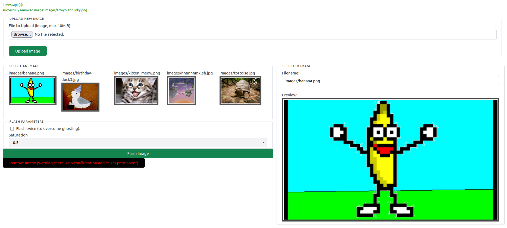
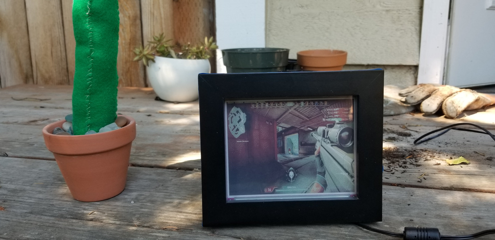

# Inky Soup

Inky Soup is a web app for displaying photos on Pimoroni Inky Impression e-ink
screens, running on a Raspberry Pi Zero W or Zero 2 W.

Upload photos, choose how they fit the screen, adjust color and dithering, and
send the result to the display. The browser performs image processing; the Pi
stores originals and derived images and runs the display update queue.




## Device setup and access

The deployment path is a complete Yocto Linux image. Follow the
[build, SD card flash, and update guide](yocto/README.md). It includes SSH key
injection, WiFi setup, persistent storage, and A/B root filesystem updates.

With a configured device:

- WiFi: open `http://inky-soup.local:8000` or run `ssh inky@inky-soup.local`.
- USB: follow the [USB Ethernet setup](yocto/README.md#usb-ethernet-pi-zero-w--zero-2-w),
  then open `http://10.55.0.1:8000` or run `ssh inky@10.55.0.1`.

The display code supports the 5.7-inch (600 × 448) and 13.3-inch 2025
(1600 × 1200) Inky Impression models. The display configuration API provides the
dimensions used by the browser.

## Local control CLI

Use the Rust client from this checkout (tested with Rust 1.94.1):

```bash
./inky-cli status
./inky-cli --device http://inky-soup.local:8000 images
./inky-cli upload screen.png --prepared --flash --wait
./inky-cli job 1 --wait --json
```

The default target is the Pi over USB Ethernet. `--prepared` requires a PNG with
the display’s exact dimensions and native palette; a normal photo can be uploaded
without that option and processed in the browser. See the [CLI guide](cli/README.md)
for installation, scripting, and job recovery.

## Local development

Install Rust and Node.js (CI uses Rust 1.85.0 and Node.js 24), then:

```bash
git submodule update --init --recursive
cd upload-server
npm ci
cargo run --locked
```

Open `http://localhost:8000`. A local server supports gallery and image-processing
development; updating a physical display requires the Pi's hardware and installed
display script. See the [server development guide](upload-server/README.md) for
configuration, Docker, and browser tests.

## Checks

```bash
cd upload-server
npm run lint
npm test
npm run test:coverage
cargo test --locked
```

USB script tests run without a connected device:

```bash
cd yocto
npm run test:usb
```

GitHub Actions runs frontend lint/unit tests, Rust unit tests, and USB script
checks on pull requests and pushes to `main`. Yocto builds, browser E2E tests,
and physical display checks are separate validation steps.

## Project layout

- `cli/`: local Rust client for USB/WiFi control and automation.
- `upload-server/`: Rust/Rocket server, browser JavaScript, templates, and tests.
- `update-image.py`: display update script; the packaged copy lives under
  `yocto/meta-inky-soup/recipes-inky-soup/inky-soup-display/files/`.
- `yocto/`: KAS configurations, image recipes, build/flash/update helpers.
- `yocto/pi-base/`: shared infrastructure submodule.
- [JS_STYLE_GUIDE.md](JS_STYLE_GUIDE.md): JavaScript conventions.
- [CLAUDE.md](CLAUDE.md): architecture and implementation notes.

## Planned work

- [Settings and display mounting orientation (#3)](https://github.com/aortez/inky-soup/issues/3),
  with implementation parked in [PR #5](https://github.com/aortez/inky-soup/pull/5).
- [Favorites and scheduled image cycling (#4)](https://github.com/aortez/inky-soup/issues/4).

These features are separate from the current manual photo-display workflow.

Older UX backlog items to reassess include notifying read-only viewers when an
image is deleted, limiting gallery size, and interactive cropping.
