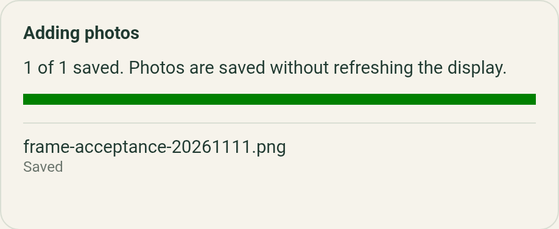

# Android acceptance on November 11 2026

Both frames were updated over Wi-Fi SSH to server revision `a422fcf`, then passed
phone-driven photo import, editing, rotation, display refresh and job recovery
checks. The owner confirmed both physical color cards looked correct. Their
original pictures and photo libraries were restored after testing.

The signed Android 0.2.2 app exposed an Add photos bug: returning from Android's
picker starts a reconnect before its file result arrives, so the import handler
silently rejects the selection. The fix retains that selection until reconnection
verifies the intended frame. A separate debug installation tested the fix; the
regular signed app and its draft remain intact. A signed release containing the
fix is still required for [#25](https://github.com/aortez/inky-soup/issues/25).

Later the same day, the [signed 0.2.3 follow-up](android-release-0.2.3.md)
completed publication, the normal in-app update and picker imports on both
frames. The remainder of this record describes the earlier debug-APK run.

## Deployment

- Small: Pi Zero 2 W, 5.7-inch seven-color panel, `192.168.1.100`, 600 × 448,
  mount 0°, revision 0.
- Large: Pi Zero W, 13.3-inch 2025 six-color panel, `192.168.1.109`, 1600 × 1200,
  mount 0°, revision 4.
- Both use reserved Wi-Fi addresses on `onionchan`; device operations in this
  run used their Wi-Fi IPs and SSH. The Pixel was connected over ADB.
- Release source: `a422fcfe3b12197025ae7410c20ae2c3822f5e86`. The checkout's tracked
  tree matched that revision when the bundle was built, before the picker fix.
- Server build: Rust 1.85.0, Zig 0.14.1, target `arm-unknown-linux-gnueabihf`,
  CPU `arm1176jzf-s`. ELF attributes confirmed ARMv6 and VFPv2; required glibc
  versions did not exceed 2.28. This executable runs on both models.
- Server SHA-256:
  `c05dfc8e2dab0c3ddde74163838d08b3135fc45d4eec02d03cbcc4fb14f3dd4e`.
- Each staged bundle passed a native startup test on port 18081 with disposable
  image/data directories and a disabled display command. The empty gallery and
  JSON 404 response passed before replacing either live server.
- `inky-cli deploy` updated the small frame first, followed by the large frame.
  The guarded deployment kept software backups at
  `/var/lib/inky-soup/deployments/9ac005a340cc41699c159b20a85d63b3` (small) and
  `/var/lib/inky-soup/deployments/ba3fc54acb5344078a99a10cfe0c434f` (large).
- Installed payload hashes matched the release manifest. Display scripts already
  matched the release. Provisioners were preserved and remained healthy.

## Phone and physical checks

The Pixel 9 Pro XL retained signed 0.2.2/build 2002. The signed APK's SHA-256
still matched `c303df80e01da67071d8d0e11451c844ed704af0cbc603432578f3f2381e24e8`.
The test APK used `pizza.allan.frame.acceptance`, a separate debug signature and
app data. Its final APK and source hashes are in the
[machine-readable record](android-acceptance-2026-11-11.json).

1. Reproduced discarded picker selections twice in signed 0.2.2, without adding
   a photo. The regular app's existing aquarium draft was preserved.
2. Imported the disposable `frame-acceptance-20261111.png` through Android's real
   picker, using Browse and selecting the exact Downloads filename, on each
   frame. Downloaded originals matched the fixture byte-for-byte; cache, thumbnail
   and dithered outputs were ready.
3. Opened the imported photo through native download/edit locking. Saved source
   rotation at 90° and then 0° on each model, with ready assets and accepted
   revision checks after each save.
4. Submitted one physical refresh from the test app on each frame. Backgrounded
   and force-stopped the app while that job was flashing, then relaunched it.
   Both reconciled job 1 to Completed. Server journals recorded exactly one
   submission for each test photo.
5. Checked digital output: exactly seven native colors at 600 × 448 and six at
   1600 × 1200. The large panel dithers the fixture's additional orange bar.
   The owner's visual confirmation was: “Both look correct”.
6. Refined the fix to queue imports during resume's full identity/address
   verification. Rebuilt the separate test APK and repeated real picker imports
   on both frames with the final implementation. This final pass saved each
   original unchanged and produced ready derived assets. The physical-job checks
   above ran earlier during development; the final pass exercised import handling.

Final-build import results on the actual phone:

## Automated verification

- Server: 35 Rust tests passed.
- CLI: 27 Rust tests passed, including deployment recovery/preservation coverage.
- Legacy frontend: 136 tests passed; lint had no errors and existing warnings.
- Shared app: 76 unit tests and 45 Android-bundle browser tests passed.
- The initial regression failed on the original resume behavior. Four final
  cases cover picker results before/during resume, with stable/reused addresses.
  No upload starts until the selected identity is verified; a moved frame receives
  uploads only at its verified new address.
- Modified app modules pass undefined-name/unused-variable lint; the separate
  debug APK builds with JDK 21 and Android SDK 36.

## Final state and remaining acceptance

Original display PNGs were captured before the first test refresh. Prepared
uploads restored those exact pixels; both restoration jobs completed and the
resulting rescue snapshot hashes matched the originals. Exactly three disposable
gallery entries per frame were removed: the first test import, final-build test
import and restoration upload.

All 36 original-photo/metadata hashes match the baseline: three originals and
three metadata files on the small frame, 15 of each on the large frame. Mounts
and persistent identities are unchanged. Both servers and provisioners are active;
both display queues are idle. Staged deployment bundles were removed, while the
software backups remain.

The separate test app and Downloads fixture were removed. The regular signed app
again selects the large frame with its aquarium draft and checked adjustments
preserved. The phone's original keep-awake setting was restored.

The picker fix is not in public 0.2.2. Signed-release validation, clean browser
installation, remaining BLE/mount/offline cases, deliberate lost submission
responses and updater failure/deferral cases remain in the
[acceptance audit](android-acceptance-audit.md). The November 1 installer-cancellation
banner wording also remains a separate follow-up. This run does not close #25.
