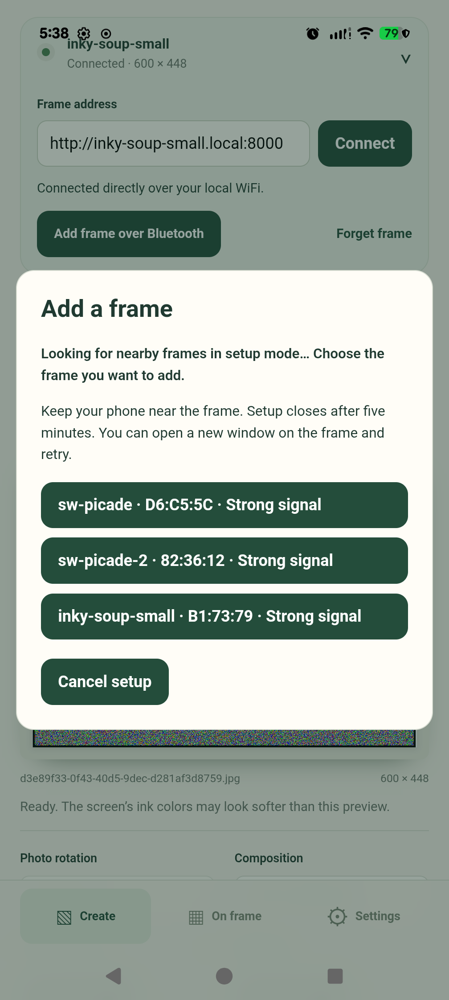
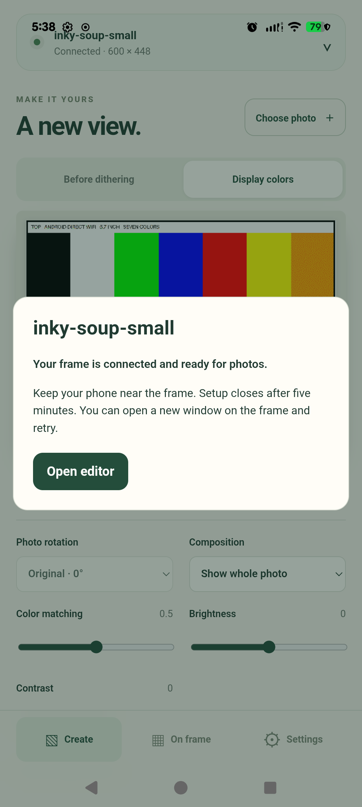

# Android Bluetooth setup validation

Local date: 2026-10-25. Issue #22, using the #21 direct-Pi adapter.

## Hardware and scope

- Pixel 9 Pro XL, Android 17, WebView 155.0.8059.39.
- Pi Zero 2 W, `inky-soup-small`, 5.7-inch seven-color display, 600 × 448.
- Existing Improv firmware; no provisioner changes or second protocol.
- The app was updated in place to preserve its existing photo draft. Fresh app
  storage is covered by the Android-bundle browser test, rather than uninstalling
  the user's app.

The recorded BLE pass used APK SHA-256
`d77da87256edf3adcc6c84a768570a70ce0370319a2ead36d501e34cc4e464c0`.
The final rescan-cancellation guard was added afterward. Retesting the final APK
and sending a physical photo are pending phone availability.

## Completed device checks

The first manual pass denied the Android Nearby devices prompt, verified an
explanation/retry path, then allowed the permission at the next scan. The scan
listed several Improv peripherals with distinct names/address suffixes; only
`88:A2:9E:B1:73:79` (the small Pi) was selected.

`app/tools/android-ble-check.mjs` then verified native GATT connection,
cancellation/reconnection, a failed credential attempt, and successful retry.
A 32-byte Unicode SSID and 64-byte Unicode password were sent as one 101-byte
Improv packet to a nonexistent network. Firmware returned WiFi connection failure,
confirming the native write was accepted and decoded. Credentials were cleared.

Retrying with the Pi's existing WiFi settings returned
`http://inky-soup-small.local:8000`. The app read its real display configuration
and gallery through native HTTP, reported `Connected · 600 × 448`, and opened the
editor without a browser or manual address entry. No WebView page errors occurred.
See [machine-readable results](android-ble-pixel9.json).

Credentials were read into memory from the selected Pi for same-network testing;
no real SSID/password is retained in these artifacts. The phone's keep-awake
setting was restored, and the Pi's setup window closed following successful setup.
Other discovered peripherals were not connected to or configured.

## Automated validation

- 38 Node unit tests, including cancellation races and protocol boundaries.
- 8 Java tests, including native packet length/checksum/UTF-8 validation.
- Android lint: zero errors (12 informational/style/dependency warnings).
- 51 web tests; 8 PWA tests; 11 Android-bundle tests.
- Debug APK build and `git diff --check`.

Mocks cover Bluetooth-off, denied permission, setup expiry, disconnect, timeout,
late GATT results, cancelled API verification, and success-with-unreachable-API
retry. The controller's polling path covers older firmware without notifications.
These are not claims of physical testing on older Android versions or every
failure mode. No OS bonding or persistent device ownership is introduced.
