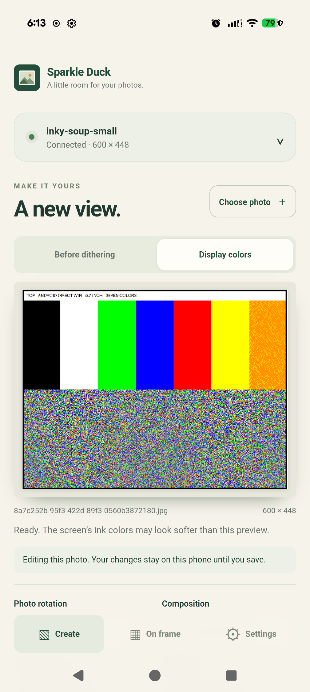

# Android Bluetooth setup validation

Local date: 2026-10-25. Issue #22, using the #21 direct-Pi adapter.

## Hardware and scope

- Pixel 9 Pro XL, Android 17, WebView 155.0.8059.39.
- Pi Zero 2 W, `inky-soup-small`, 5.7-inch seven-color display, 600 × 448.
- Existing Improv firmware; no provisioner changes or second protocol.
- The app was updated in place to preserve its existing photo draft. Fresh app
  storage is covered by the Android-bundle browser test, rather than uninstalling
  the user's app.

The hardware-tested APK matched its built artifact, SHA-256
`246d6880c12505db4c07bc1b95fea6c25b3c3d04a03c038f2e426843fa30780a`.

## Completed device checks

The first manual pass denied the Android Nearby devices prompt, verified an
explanation/retry path, then allowed the permission at the next scan. A later
Bluetooth-off state produced the expected recovery message; the app’s settings
link opened Android Settings and Bluetooth was enabled for testing. The scan
listed several Improv peripherals with distinct names/address suffixes; only
`88:A2:9E:B1:73:79` (the small Pi) was selected.

`app/tools/android-ble-check.mjs` then verified native GATT connection,
cancellation/reconnection, a failed credential attempt, and successful retry.
Closing the setup window with the existing CLI while GATT was connected produced
recoverable feedback, and reopening it allowed a fresh connection.
A 32-byte Unicode SSID and 64-byte Unicode password were sent as one 101-byte
Improv packet to a nonexistent network. Firmware returned WiFi connection failure,
confirming the native write was accepted and decoded. Credentials were cleared.

Retrying with the Pi's existing WiFi settings returned
`http://inky-soup-small.local:8000`. The app read its real display configuration
and gallery through native HTTP, reported `Connected · 600 × 448`, and opened the
editor without a browser or manual address entry. No WebView page errors occurred.
See [machine-readable results](android-ble-pixel9.json).


Credentials were read into memory from the selected Pi for same-network testing;
no real SSID/password is retained in these artifacts. The phone's keep-awake
setting was restored to 0, Bluetooth was restored to off (its state when the phone
was returned for the final pass), and the Pi's setup window closed following setup.
Other discovered peripherals were not connected to or configured.

## Photo through the provisioned connection

With the editor still connected to the BLE-returned `.local` address, ran:

```sh
node app/tools/android-pi-check.mjs --serial PHONE_SERIAL \
  --device http://192.168.1.149:8000 --connected \
  --photo /tmp/inky-android-wifi-large.jpg --flash --output /tmp/inky-22-photo.json
```

The app sent the 18,992,047-byte synthetic JPEG and its derived PNGs without
re-entering or replacing the connection address. The upload/refresh completed in
45,216 ms; CLI independently confirmed **job 7, Completed** (about 36 seconds of
physical refresh). It then downloaded/reopened the original and acquired its edit
lock. Native transfer files were empty and there were no external WebView HTTP
requests or page errors.

The seven-bar/TOP/detail pattern is the same fixture used in #21. This run records
successful driver completion and the inspected app preview, without a new human
visual confirmation of the physical panel. The latest disposable photo is
`8a7c252b-95f3-422d-89f3-0560b3872180.jpg`; the previous known disposable fixture
from job 6 was deleted after success. Other photos were preserved.

See [photo/CLI results](android-ble-photo.json).



## Automated validation

- 39 Node unit tests, including cancellation races and protocol boundaries.
- 8 Java tests, including native packet length/checksum/UTF-8 validation.
- Android lint: zero errors (12 informational/style/dependency warnings).
- 51 web tests; 8 PWA tests; 12 Android-bundle tests.
- Debug APK build and `git diff --check`.

Mocks cover Bluetooth-off, denied permission, setup expiry, disconnect, timeout,
late GATT results, cancelled API verification, and success-with-unreachable-API
retry. The controller's polling path covers older firmware without notifications.
Bluetooth-off, permission denial, cancellation, explicit firmware-window closure,
failed credentials, and successful retry also ran on the real phone. Tests are not
claims of physical coverage on older Android versions or every failure mode. No OS bonding or persistent device ownership is introduced.


## PR review follow-up

Review reproduced a queued BLE disconnect aborting HTTP verification after the
acknowledged write and validated local-address handoff. The controller now ignores
BLE events once that handoff is accepted; explicit user cancellation still aborts
the HTTP operation. Regression tests cover both in-flight API verification and
its retry after an unreachable API. The new unit test failed before the fix;
all 39 Node tests and 12 Android-bundle tests pass afterward, including the
existing explicit-cancellation tests. The debug APK also builds successfully.

The recorded physical run above predates this three-line event guard; it was not
repeated for this review fix. Native GATT, firmware, HTTP transport, and the photo
pipeline are unchanged.
