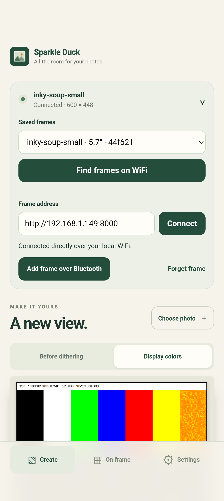
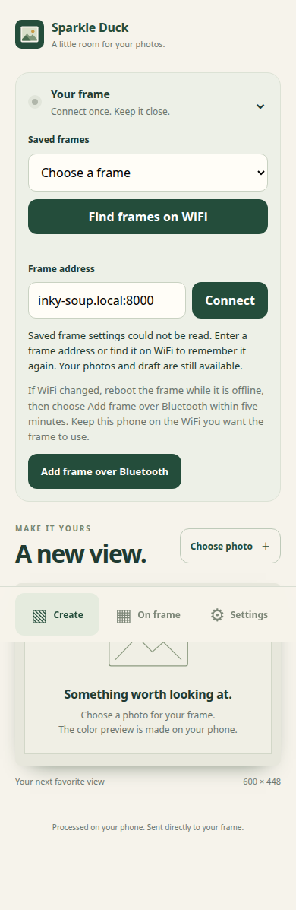

# Android remembered-frame validation (#23)

Validated 2026-10-25 on a Pixel 9 Pro XL (Android 17) and a Pi Zero 2 W with
5.7-inch Inky Impression, 600 × 448, mount 0°. The large Pi was reserved for the
other checkout's #17 work and was not deployed to or rebooted.

## Automated checks

- App unit tests: 46 passed, including persistent registry/selection/forget,
  mismatched identities, discovery changes/cancellation, draft rotation receipts,
  and device/server-instance job reconciliation.
- Android bundle tests: 21 passed. New coverage includes same-name frames with
  different panels, IP reuse, identity changes during connection, app resume,
  read-only job reconciliation, unavailable/denied discovery, and reacquiring a
  draft edit lease at the verified new address.
- Web: 51 passed. PWA: 8 passed.
- Server: 27 passed, including concurrent identity initialization, restart
  persistence, corrupt-file refusal, and the real Rocket identity route.
- CLI: 26 Rust tests passed, including HTTP identity diagnostics and its Python
  deployment regression suite (11 tests). Deployment adds the Avahi service on
  older images and removes it when rolling back a failed first installation.
- Debug APK build, 8 Java tests, Android lint (0 errors; 12 existing warnings),
  CLI formatting and `git diff --check` passed.
- ARMv6-compatible server cross-build completed. Full Yocto image build was not
  repeated for this change; the Avahi recipe asset was exercised on the small Pi.

## Physical results

1. Installed the new APK as an update, preserving the existing draft. The old
   address-only frame association migrated after reading `/api/device`.
2. Find frames on WiFi discovered `inky-soup-small` with native Android NSD.
3. Temporarily cloned the Pi's WiFi profile and changed its DHCP client ID. Its
   lease changed from `192.168.1.149` to `192.168.1.101`. On resume, the phone found
   the new address without entering an address or opening Bluetooth setup. The
   persisted device ID remained `72d38d6af1b56f99ae0fb4407f44f621`.
4. Force-stopped and restarted the Android app; it reconnected to `.101` using
   the saved registry.
5. Rebooted the Pi. Its normal profile restored `.149`; the phone rediscovered
   it, retained the same ID, and observed a new server instance. Deleted the
   temporary WiFi profile afterward.
6. Submitted one orientation card through the Android UI, backgrounded the app,
   and resumed while it was refreshing. It reconciled job #1 through Completed;
   independent CLI reads confirmed that job and an empty queue. No second
   refresh was submitted. This checks job reconciliation, not a new visual panel
   acceptance; no fresh user confirmation of the physical card was requested.
7. Updated to the final APK, reopened a real gallery original, backgrounded and
   resumed, and confirmed its editing lease and enabled controls were restored.
   Final APK SHA-256:
   `d97cd94c9a633d7c12df5459af6c68e1cf3251b7e891e15ef38c2c57c00e066e`.

An initial lease-change experiment using a random WiFi MAC received `.104` but
was unreachable from the host/phone, despite reaching the gateway from the Pi.
The successful test kept the permanent MAC and changed only the DHCP client ID.
USB IPv6 access was retained throughout. The Pi is back on its original profile
at `.149`. Phone Bluetooth remains off and keep-awake is restored to its initial
value of 0.

## Remaining acceptance

- Both physical Pis selected from the same registry, once the large Pi is free.
  The two-panel/same-name case is covered by Android bundle tests meanwhile.
- End-to-end offline rescue card, five-minute BLE setup and photo restoration
  with the merged #17 firmware. App recovery instructions use the existing
  reboot-while-offline setup window and defer rescue ownership to #17.
- A real Android local-network permission-denial scenario on an OS/target that
  enforces it; denied discovery and recovery UI are covered with the native
  bridge fixture. SDK 37 permission migration remains a separate follow-up.

Keep #23 open and the implementation PR in draft until the reserved-device and
#17 integration acceptance can be completed.

## PR review fixes

Both reported bugs were reproduced with Android bundle tests before the fixes:
selecting another frame after an unavailable startup discarded its saved job,
and completing a remembered refresh left the original draft read-only.

Job receipts now persist per device, migrate the prior single receipt, and expire
independently when completed or explicitly forgotten. Completion restores the
current draft's edit lease before releasing the job's UI guard. Tests cover
switching away and back across app restart, retaining two jobs, completed/failed
refreshes, and selection staying disabled while completion cleanup is pending.

Updated validation: 50 app unit tests, 25 Android bundle tests, 51 web tests, and
8 PWA tests passed. The updated APK builds successfully. These review fixes have
not been installed or physically retested on the phone; the hardware record and
APK checksum above describe the preceding build. The remaining acceptance list
is unchanged.

## Connect-flow review follow-up

Four additional Android bundle regressions failed before the fixes: manually
adding another frame while one is selected, connecting with a corrupt registry,
recovering from a picker persistence error, and exposing refresh-status retry
after a failed automatic reconnect. All four now pass. The manual-address case
starts with only one saved frame and denies discovery; the second frame is added
and remains selected after restart. The picker also keeps a stable name/ID order.

Identity probes now combine caller cancellation and a four-second deadline with
an AbortController, without depending on AbortSignal.any. Unit tests exercise
success, pre-cancellation, cancellation in flight, listener cleanup and deadline
expiry. Restored device-ID files accept LF/CRLF endings while rejecting malformed
IDs without changing the file. BLE capability metadata is advertised only when
`/usr/bin/wifi-provisioner` is installed. Web reconnect again releases its old
edit lease before the handshake, with a request-order regression test.

Latest checks: 53 app unit, 29 Android bundle, 52 web and 8 PWA tests passed.
After merging the offline-rescue work from main (#34), all 34 server and 27 CLI
Rust tests passed, including 11 deployment Python regressions. The 19 Python
display/recovery-card tests and provisioner source-pin check also passed. Debug APK build, 8 Java tests and Android lint passed (0 errors,
12 existing warnings). Per-poll identity verification is retained so a reused
address or restarted server cannot lend an old receipt a different job's status.

These changes have not been installed on the phone or either Pi. The physical
record above predates both review-fix rounds; two-Pi and #17 acceptance remain
required before leaving draft. No full Yocto build was run for this follow-up.

Recovery notice captured from the Android bundle with the mocked native bridge
(390-pixel viewport; this is not a physical-phone screenshot):

The main-branch integration preserves both identity/discovery and offline rescue:
CLI documentation and tests include both commands, and the Yocto recipe includes
both Avahi and NetworkManager CLI runtime dependencies. The shared provisioner
checkout matches main's updated submodule revision. This resolves the merge
conflicts that prevented PR CI from starting; it does not replace the remaining
physical acceptance.
