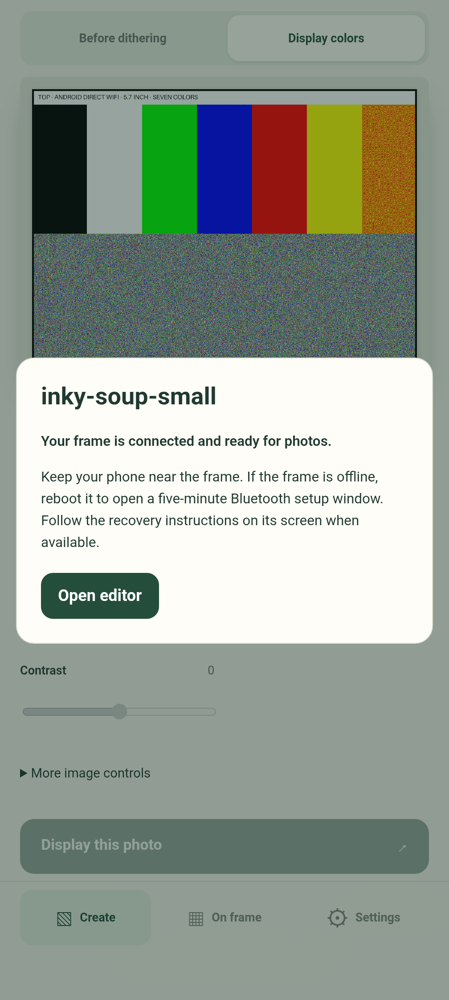

# Android remembered-frame validation (#23)

Hardware acceptance passed on 2026-10-25 (2026-10-26 UTC), using a Pixel 9 Pro XL
on Android 17 and both physical frames: Pi Zero 2 W / 5.7-inch Impression
(600 × 448, mount 0°) and Pi Zero W / 13.3-inch Impression (1600 × 1200,
mount 180°). The final debug APK includes all review fixes and the durable frame
selection fix discovered during this acceptance run.

## Automated checks

- App unit: 54 passed; Android bundle: 31 passed; web: 52 passed; PWA: 8 passed.
- Server: 34 Rust tests passed. CLI: 27 Rust tests passed, including the Python
  deployment suite (25 tests after integration with #36).
- Python display/recovery-card tests: 19 passed; provisioner source-pin check passed.
- Debug APK build and 8 Java tests passed. Android lint: 0 errors, 12 existing warnings.
- Pre-commit legacy lint and 130 JavaScript tests passed.

Coverage includes manual addition of a second frame without discovery, corrupt
registry recovery, picker persistence failures, stable picker ordering, identity
changes during a handshake, same-name frames, reused addresses, cancellation and
request deadlines without AbortSignal.any, per-frame job receipts, read-only job
reconciliation, retry after failed reconnect, and edit lease recovery. Restored
device-ID files accept LF/CRLF; BLE capabilities require an installed provisioner.
Web reconnect releases its previous edit lease.

## Physical acceptance

1. Updated the installed APK while retaining the draft and saved frames. Entered
   the large frame's address while the small frame was selected; it connected to
   the large frame without forgetting the small one. Native Android NSD discovered
   both, and the picker loaded each frame's correct display configuration.
2. Found and reproduced a persistence bug: immediately force-stopping after a
   selection could discard WebView localStorage writes and reopen the previous
   frame. Android now waits for a strict IndexedDB transaction before reporting
   registry changes as saved, and restores that committed registry at launch.
   The final APK retained the small selection across immediate force-stop and
   relaunch. Regression tests cover stale localStorage, Forget, write failure,
   and cancelling Bluetooth setup during the durable transaction.
3. Forgot and re-added the large frame. Its 15 gallery originals remained intact;
   the small frame's three originals also remained unchanged. No large-panel
   refresh was requested during this run.
4. Submitted the small frame's existing color-bar photo from Android, backgrounded
   and force-stopped the app, then relaunched it. The app reconciled the single
   job through Completed and recovered the draft edit lease and editing controls.
   Independent CLI reads confirmed completion without a duplicate submission.
   The owner confirmed: “Yes, it looks correct”.
5. Disconnected both small-Pi network transports with an independent timed
   restoration safeguard armed. The automatic recovery card waited the full
   300-second offline grace, then completed. The owner confirmed the text and QR
   code: “Yes, both are readable and upright”.
6. Rebooted the small Pi while offline to open its bounded Bluetooth setup window.
   Provisioned its original WiFi through the app's native BLE flow and followed
   the returned local URL. The app verified the same device ID with a new server
   instance and retained both registry entries. No SSH command provisioned WiFi.
7. After the 30-second stable-network interval, the Pi automatically restored its
   photo. The restore job completed, the saved photo matched the prepared image's
   SHA-256, and rescue status returned to connected with no active card or error.
8. Restored original WiFi/USB profiles and USB recovery service, removed the
   temporary failsafe timer and credentials, and restored phone Bluetooth to off
   and keep-awake to 0. Both Pis remained available on their original WiFi addresses.

Earlier validation also changed the small Pi's DHCP address from `.149` to `.101`:
the app rediscovered it on resume and after restart, retaining its device ID.
A Pi reboot restored `.149`, which the app rediscovered again. The temporary
profile was removed. The final run above rechecked reboot identity and reconnection
through the merged offline-rescue firmware.

## Deployment and evidence

The final debug APK SHA-256 is
`778fcec306d7c04a9f41c27462b6ec922d4c7158a0a4c1ec987e4f3dcbade4af`.
Both servers ran revision `ac70c96f416c9487c9e8e82938cb32e3cd839af7`;
subsequent changes affect the Android app, deployment helper, tests and documentation.
The small Pi received the paired server/provisioner deployment. Both provisioners
matched the updated source used by the merged offline-rescue work.

The first GCC-linked server build failed on the original Pi Zero W and the
installer rolled back successfully. Rebuilding with Rust 1.85.0 and the proven
Zig ARMv6 linker produced a working release. A first BLE attempt overlapped the
test harness's reboot and disconnected; normal app rescan/retry succeeded after
boot. Neither failure is hidden in the recorded acceptance evidence.

Integration with #36 preserves discovery installation alongside paired
server/provisioner deployment. A regression checks that failed first-time
discovery installation removes the new file and restores both old binaries and
services, while preserving photos and settings.

[Machine-readable hardware evidence](android-reconnect-final.json) records deploy
results, job receipts, outage events, identities, photo hashes and cleanup.

## Scope and remaining follow-ups

The #23 hardware gate is complete. This run used a software reboot, not physical
power removal, and did not rebuild a full Yocto image. Android OS-enforced local
network permission denial was not available with the current target; native
discovery denial and recovery are covered by bundle tests. Signed APK distribution
and updates remain #24; broader release acceptance remains #25.
