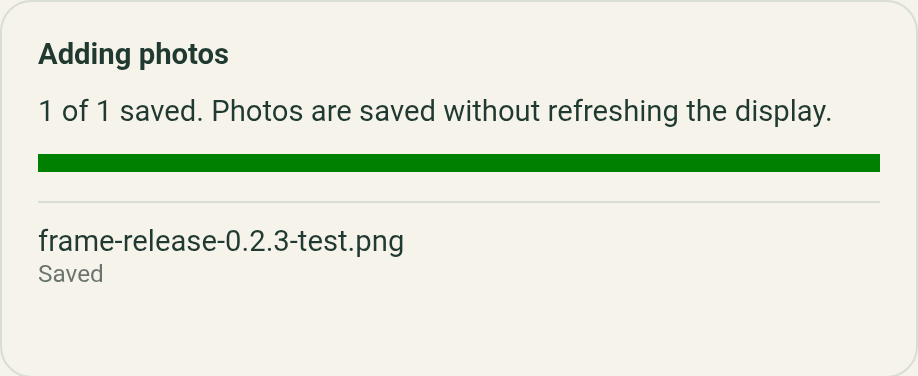

# Frame 0.2.3 signed-release verification

Verified on November 11, 2026. [Frame 0.2.3](https://github.com/aortez/inky-soup/releases/tag/app-v0.2.3)
was published and installed over the existing signed 0.2.2 app through its own
updater. The Pixel retained both frames and its exact draft. Android's real
Add photos picker saved a disposable photo on each frame with unchanged original
bytes and ready derived assets. Test entries were removed afterwards.

This is the signed follow-up to the earlier
[separate debug-APK hardware run](android-acceptance-2026-11-11.md), not a repeat
of its physical refresh checks. The complete
[#25 acceptance checklist](android-acceptance-audit.md) remains open.

## Release and automated checks

- [PR #59](https://github.com/aortez/inky-soup/pull/59) merged as
  `6867d5b8c42e3cc4203517ae8b46e51e6c11194f`; `app-v0.2.3` tags that commit.
- All eight PR checks passed. The [release workflow](https://github.com/aortez/inky-soup/actions/runs/43120630181)
  passed its web, Android and publishing jobs.
- Local app checks passed: 76 unit, 53 web browser, eight installed-PWA,
  46 Android-bundle browser and 19 Java release unit tests. The release APK
  assembled and Android release lint passed.
- The additional resume regression covers failed identity verification: the
  selection produces an explicit retry message and sends no photo upload.
- Version name/code: `0.2.3` / `2003`, application ID `pizza.allan.frame`.
- APK SHA-256:
  `ba05a98663ce71d9071da344d6c79466fce7eb1c7b684f789691194da8a89535`.
- Signing-certificate SHA-256, matching earlier public versions:
  `323dc7c2a994fa3217530c2fa8e7beffc1fc9ed4b4c6c43e92e29baebc7ea605`.
- The APK and web archive passed their published checksum checks. Rolling
  `frame-app` metadata and APK matched the versioned 0.2.3 assets.

## Forward update on the Pixel

Phone: Pixel 9 Pro XL, Android 17 / SDK 37, build `CP2A.260605.016`, WebView
`155.0.8059.39`. ADB observed and operated the phone UI; the APK installation
used the normal updater and Android installer rather than `adb install`.

1. In signed 0.2.2, used Settings → Check for updates → Download update.
   The app offered 0.2.3 and reported its verified download ready to install.
2. Used Install update, chose Package installer for this invocation and confirmed
   Update. Play Protect scanned the APK and reported “This app looks safe”.
   Confirmed Install, then Open after Android reported the app updated.
3. Android reported 0.2.3/build 2003. The installed APK, pulled for inspection,
   exactly matched the published checksum and release certificate.
4. Compared snapshots taken before and after the update, then again after all
   frame tests. Both comparisons matched exactly: complete remembered-frame
   registry, selected large frame, draft metadata, draft blob SHA-256, nine
   displayed draft controls and preview preference. The preview preference was
   unset; a non-default preview-profile migration was not exercised. There was
   no saved display-job receipt in this update test.

The app was neither uninstalled nor cleared. Its existing aquarium draft retained
contain fit, 0° source rotation, saturation 0.6, brightness 25, contrast -10,
Lanczos filtering and Atkinson dithering.

## Signed picker imports on both frames

The disposable fixture was `frame-release-0.2.3-test.png`, 1600 × 1200, SHA-256
`9d6809de1b08c118fb4c09aeabf46a115443f08aed4adf08fe187819df46b470`.
On each selected frame, used Gallery → Add photos → Browse → the exact Downloads
filename. The app returned through its resume/reconnect flow and saved the photo.
Downloaded originals matched the fixture exactly; the API reported thumbnails
ready and `needs_processing: false`. Display queues remained idle.

One initial small-frame return showed “Could not add the selected photos” with an
explicit reconnect/retry instruction and created no photo. The specific rejected
connection or identity condition was not captured. Two subsequent small-frame
imports passed: one with a debugger observing the resume state, then another
without debugger tracing. The observed successful resume verified the intended
device ID before importing. The large-frame import also passed without tracing.
This record retains the initial retry as an observation rather than claiming
every attempt succeeded.

| Frame | Hardware | Wi-Fi address | Saved imports |
| --- | --- | --- | --- |
| Small | Pi Zero 2 W, 5.7-inch seven-color, 600 × 448 | `192.168.1.100` | Two; both originals verified, both removed |
| Large | Pi Zero W, 13.3-inch 2025 six-color, 1600 × 1200 | `192.168.1.109` | One; original verified, removed |

Completion panels from the final import on each model are identical:

## Preservation and remaining work

Both frames remained on reserved `onionchan` Wi-Fi addresses; Pi access used
Wi-Fi HTTP and SSH only. Their servers stayed on `a422fcf`, deployed earlier in
the hardware run. This release check did not deploy firmware or submit a display
refresh.

After removing exactly the three identified test entries, all 36 original-photo
and metadata file hashes matched the baseline: three photos plus three metadata
files on the small frame, 15 of each on the large. Galleries, device IDs, server
instances, mounts and saved display-snapshot hashes also matched. Both server
and provisioner services were active, rescue cards inactive, and queues idle.

The phone again selected the large frame and showed its original draft. The
temporary Downloads fixture was removed and the original keep-awake setting
restored to 0. Detailed identifiers, checksums and preservation results are in
the [machine-readable record](android-release-0.2.3.json).

This passes the ordinary signed forward-update and picker-import checks. Clean
browser installation, signed physical refresh/edit/mount coverage, controlled
network interruptions, remaining BLE/offline recovery cases and updater
failure/active-job deferral checks remain in the acceptance audit. The earlier
installer-cancellation banner wording remains a separate follow-up. #25 stays
open and the legacy Pi UI remains available.
