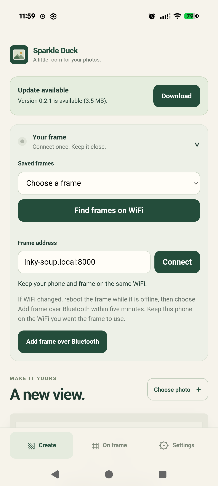
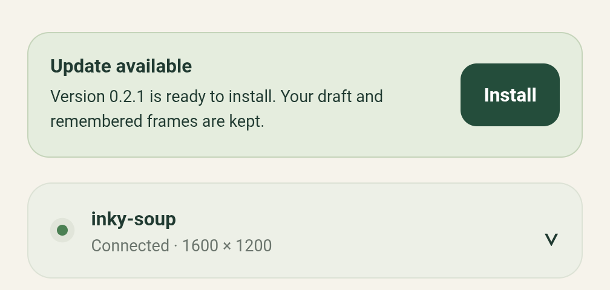
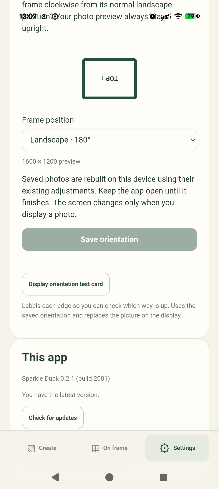

# Android in-app update validation

Local date: 2026-10-26. Issue #24, using the signed releases from
[docs/android-release.md](../android-release.md).

## Hardware and scope

- Pixel 9 Pro XL, Android 17 (build CP2A.260605.016, security patch 2026-10-01),
  WebView 155.0.8059.39.
- Frame `inky-soup` with a 1600 × 1200 display, reached over the local network.
- Release `app-v0.2.0` (build 2000) was replaced by `app-v0.2.1` (build 2001). Both
  were built and published by the release workflow from tags on `main` and are
  signed by the certificate with SHA-256
  `323dc7c2a994fa3217530c2fa8e7beffc1fc9ed4b4c6c43e92e29baebc7ea605`. The APK
  digests are in the [machine-readable results](android-update-pixel9.json).
- The phone carried the debug-signed 0.1.0 build, which a release cannot update.
  It was uninstalled deliberately, discarding its draft, and 0.2.0 was installed
  over ADB from the versioned asset after checking `frame.apk.sha256`. Installing
  from the download link in the phone's browser was not exercised in this pass.

## Completed device checks

On its first launch, 0.2.0 read the live `frame-app` metadata and offered
"Version 0.2.1 is available (3.5 MB)" with a **Download** button. Neither release
carried notes, so the banner showed none.

To have state to check afterwards, the prefilled address was connected, which
remembered the frame as `Connected · 1600 × 1200`, a photo (`2048.png`) was chosen,
and Brightness was set to 75.

The download completed and verified in under two seconds on WiFi. The banner then
read "Version 0.2.1 is ready to install. Your draft and remembered frames are
kept." with **Install**.

The first **Install** opened Android's **Install unknown apps** page for Sparkle
Duck. Leaving that page without allowing the source returned to a usable app that
kept the verified download. While the frame reconnected after the switch, the
banner briefly disabled **Install** with "Finish the current task before
installing.", then offered it again with "Allow Sparkle Duck to install updates
in Android Settings, then tap Install again." once connected.

After allowing the source, **Install** handed the package to the Android
installer. Google Play Protect scanned it before the confirmation, which happens
for every package installed outside Google Play, and the app was replaced.

Reopened, the app reported build 2001 (`versionName` 0.2.1) with the same signer.
The frame reconnected, the draft still showed `2048.png` with Brightness 75, and
the banner was gone. Settings read "Sparkle Duck 0.2.1 (build 2001)", and a manual
**Check for updates** reported "You have the latest version."

## Not yet exercised

- Item 1, the first install from the download link in the phone's browser, with
  the browser's own permission to install unknown apps.
- Item 4, cancelling the Android installer dialog itself. Declining the install
  permission was covered.
- Item 5, interrupting a download. A 3.5 MB package finishes too quickly on WiFi to
  interrupt by hand; this needs a throttled network or a larger package.
- Item 6, metadata with a wrong checksum or a different signing digest. The app only
  reads its configured host, so this needs a test build pointing at a test server.
- Item 7, deferral behind an active display refresh. It was skipped because it
  would replace the picture on the frame.

## Observations

- Play Protect's scan adds a few seconds to every sideloaded update and cannot be
  skipped from the app. The release documentation now says so.
- The permission notice told the user to tap **Install update**, although the
  banner's button is labelled **Install**; the notice now says **Install**, which
  reads correctly for both the banner and the Settings card.
- The transient busy message during the reconnect is correct behaviour, since
  installation waits for a connection in progress, but it appears without any
  action by the user.

## Automated validation

- 69 Node unit tests and 41 Android-bundle browser tests pass after the notice
  change; the browser test checks the notice by its first sentence.
- The Java tests, Android lint, and the signed build ran in the release workflow
  for both tags, with `apksigner` confirming the signer on each APK.
- The published metadata, checksum files, and APKs were downloaded from the stable
  and versioned links and compared with the workflow artifacts before each install.
